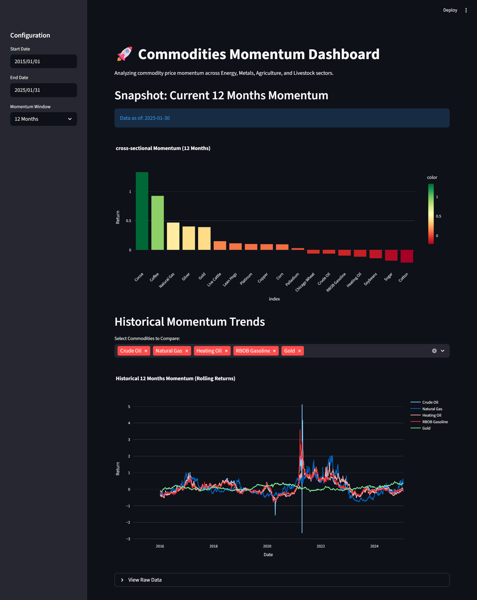
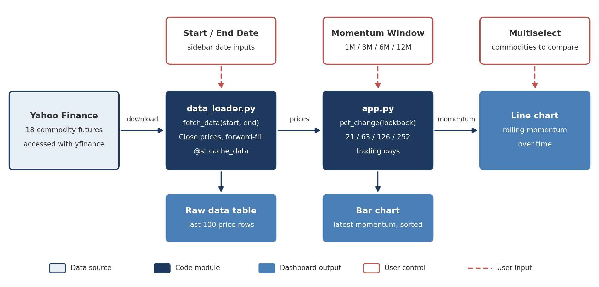

# Commodities Momentum Dashboard

> A small Streamlit dashboard that ranks 18 commodity futures by 1/3/6/12-month price momentum, using Yahoo Finance data.

원자재 선물 18종의 가격 모멘텀(기간 수익률)을 한 화면에서 비교하는 Streamlit 대시보드입니다.



*앱 실행 화면(기본 설정, 다크 모드 브라우저). 데이터는 Yahoo Finance에서 2026-11-22에 조회했습니다. 2025-01-30 기준 12개월 모멘텀은 Cocoa(+133%)가 가장 높고 Cotton(-22%)이 가장 낮습니다.*

## 개요

"최근 N개월 동안 어떤 원자재가 많이 오르고 내렸는가"를 종목 간 비교(cross-section)와 시계열 두 방향으로 보여 줍니다. 모멘텀은 단순 기간 수익률 `P_t / P_(t-L) - 1`이고, L은 21·63·126·252 거래일(1·3·6·12개월) 중에서 고릅니다. 코드는 파일 두 개, 합쳐서 224줄입니다.

| 섹터 | 종목 (Yahoo Finance 티커) |
|---|---|
| Energy | Crude Oil `CL=F`, Natural Gas `NG=F`, Heating Oil `HO=F`, RBOB Gasoline `RB=F` |
| Metals | Gold `GC=F`, Silver `SI=F`, Copper `HG=F`, Platinum `PL=F`, Palladium `PA=F` |
| Agriculture | Corn `ZC=F`, Soybeans `ZS=F`, Chicago Wheat `ZW=F`, Sugar `SB=F`, Coffee `KC=F`, Cocoa `CC=F`, Cotton `CT=F` |
| Livestock | Live Cattle `LE=F`, Lean Hogs `HE=F` |

## 기능

- **사이드바 설정**: Start Date / End Date(기본 2015-01-01 ~ 2025-01-31), Momentum Window(기본 12 Months).
- **Snapshot 막대 차트**: 조회 구간의 마지막 거래일 기준 모멘텀을 종목별로 내림차순 정렬해 보여 줍니다.
- **Historical 선 차트**: 선택한 종목의 롤링 모멘텀 시계열을 겹쳐 그립니다. 종목은 multiselect로 고르며 기본값은 앞의 5개(에너지 4종과 Gold)입니다.
- **View Raw Data**: 가격 데이터의 최근 100행을 표로 확인합니다.
- **캐싱**: `fetch_data`에 `@st.cache_data`를 적용해, 날짜 범위가 같으면 윈도우나 종목 선택을 바꿔도 다시 내려받지 않습니다.

## 구조



```
app.py            # 화면 구성, 모멘텀 계산(pct_change), Plotly 차트
data_loader.py    # 티커 정의, yfinance 다운로드, 종가 추출, forward-fill, 캐싱
requirements.txt  # streamlit, yfinance, plotly, pandas, numpy
```

## 실행 방법

```bash
python -m venv .venv
.venv\Scripts\activate            # macOS/Linux: source .venv/bin/activate
pip install -r requirements.txt "pandas<3"
streamlit run app.py
```

`requirements.txt`에는 버전이 고정되어 있지 않습니다. 2026-11-22에 새 가상환경에서 위 명령으로 설치된 조합(Python 3.13, streamlit 1.67.0, yfinance 1.8.0, plotly 7.1.0, pandas 2.3.3)으로 실행을 확인했습니다. pandas 3에서는 확인하지 않았기 때문에 위 명령에서 `pandas<3`을 함께 지정합니다. API 키는 필요 없고, 실행 중 Yahoo Finance에 접속할 수 있어야 합니다.

## 한계와 다음 단계

- **롤오버 미조정**: `=F` 티커는 근월물을 이어 붙인 연속 시세라 월물 교체 시점의 가격 차이가 수익률에 섞입니다. 실제 선물 보유 수익률과는 다릅니다.
- **음수 가격**: WTI(`CL=F`)가 2020-04-20에 -37.63달러로 마감해, 그 날짜와 252거래일 뒤(2021-04-20)의 12개월 수익률은 -100% 아래로 내려가 해석할 수 없습니다. 위 화면 선 차트의 아래쪽 스파이크 두 개가 이 값입니다.
- **모멘텀 정의가 단순함**: 최근 1개월을 제외하는 12-1 방식이나 변동성 조정은 적용하지 않았습니다.
- **섹터 구분 미활용**: 섹터는 코드에 정의되어 있지만 화면에서는 종목 단위로만 보여 줍니다.
- **캐시와 날짜**: 캐시에 만료 시간(TTL)이 없어 앱을 다시 시작하거나 캐시를 지우기 전까지 같은 날짜 범위는 갱신되지 않습니다. 또한 yfinance의 `end`는 해당 일을 포함하지 않아, 기본 설정에서 마지막 관측일은 2025-01-30입니다.
- **테마**: 배경색을 CSS로 고정해 두어 라이트 테마에서는 일부 글자가 잘 보이지 않습니다.
- **다음 단계**: 의존성 버전 고정과 deprecated API 교체(`ffill()`, `width='stretch'`), 섹터별 평균 모멘텀 추가, 음수 가격 구간 처리, 계산 로직 단위 테스트.

## 데이터 출처

가격 데이터는 [yfinance](https://github.com/ranaroussi/yfinance) 라이브러리로 Yahoo Finance에서 실행 시점에 내려받으며, 저장소에는 데이터를 포함하지 않습니다. yfinance는 Yahoo의 공식 API가 아니므로 제공 범위와 값이 예고 없이 바뀔 수 있습니다. 학습·연구용 프로젝트이며 투자 권유가 아닙니다.

---

김재하 (Jaeha Kim) · [github.com/summerjinhere](https://github.com/summerjinhere)
